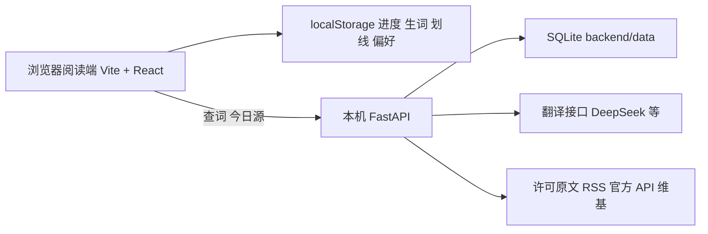

# 苏打阅读

面向中文读者的英语沉浸阅读工具：点词看行间中文，点句看译文，并可听读、划线、复习生词。

[](LICENSE)
[](package.json)
[](https://github.com/liusucheng0213/soda-reading)

网页使用 Vite + React，翻译和采集走可选的本机 FastAPI。无需登录；进度、生词、划线和偏好留在浏览器里。产品细节见 [docs/project-overview.md](docs/project-overview.md)。

## 体验路径

1. 直接打开应用；可先做大致水平测试，也可手动选择 A1–C2。
2. 进入正文，点一个词，中文语境义出现在词的正下方；可主动收藏，也可开启「生词标记」连续保存带译义的词或短语。
3. 点句末标点展开整句中文；打开朗读可暂停、再读本句、从此句朗读并划出本句。
4. 复习先选择「认识 / 不认识」，再揭示答案并确认记忆程度；忘记重排，支持完整撤销、分批继续和已掌握词库。
5. 在「我的」导出或恢复版本 2 的完整本地备份。

## 核心功能

- A1–C2 本地水平测试与今日文章切换，结果只作为大致阅读建议。
- 点词行间注、点句整句译文；代词只显示文中指代。
- 全文逐章听读、句级跟读、慢/常/快、跨章查找、复制原句和剩余分钟。
- 连续生词标记、两阶段主动回忆、分批 FSRS、忘记重排、完整撤销和可恢复的已掌握词库；「原文」回到正确章节。
- EPUB/TXT 章节目录、PDF 页码导航、按章阅读位置和全书加权进度。
- 本地 JSON 备份/恢复、书籍删除和分类清空；不包含模型密钥。
- 本机 `/admin` 保留手动采集、自动验证和模型路由；阅读端没有账号或管理入口。

## 架构

数据在浏览器、本机 API 和可选的翻译服务之间流动。



## 本地数据与离线边界

后端未启动时，开发和生产页面都可使用内置文章、本地书籍、水平测试与复习；在线今日源和云端词译需要 FastAPI。阅读交互在 `src/screens/ReaderScreen.jsx`，章节、文本切分和复习在 `packages/core`。

没填翻译密钥时，查词会失败，或只显示有限的本地语料。阅读进度、生词、划线、偏好和翻译记忆仍写在浏览器里。导入书籍使用 IndexedDB，其余个人数据使用 localStorage；「我的 → 数据管理」可导出和恢复 `schemaVersion: 2` 的完整 JSON 备份，旧版本文件不会自动迁移。

## 运行依赖

| 组件 | 说明 |
| --- | --- |
| 桌面浏览器 | 阅读、朗读（Web Speech API）、本地存储 |
| Node.js 22 | 网页开发与测试，与 CI 一致 |
| Python 3.11 | 本机 API，与 CI 一致 |
| 翻译平台账号 | 可选。默认路由是 DeepSeek，但默认付费护栏会阻断它；见 [配置指南](docs/translation-provider-setup.md) |

## 快速开始

在仓库根目录安装锁定版本的前端依赖，并创建 Python 虚拟环境：

```powershell
npm ci
py -3.11 -m venv .venv
.\.venv\Scripts\python.exe -m pip install -r backend\requirements.txt
Copy-Item .env.example .env
Copy-Item backend\.env.example backend\.env
```

阅读端不需要账号或口令。只有使用在线翻译、内容采集或管理接口时才需要配置后端环境；模型密钥只写在 `backend/.env`。数值型配置保持注释，不要写成空值。

只填写 `DEEPSEEK_API_KEY` 不会启用付费调用。DeepSeek、cheapApi 和自定义计费线路都需要显式付费开关、正数每日预算和单次上限；默认配置为零预算阻断。当前阅读端的启用示例见 [翻译配置指南](docs/translation-provider-setup.md)。

启动网页开发服务器：

```powershell
npm run dev -- --host 127.0.0.1 --port 4173 --strictPort
```

另开一个终端启动 API：

```powershell
cd backend
$env:PYTHONPATH="."
..\.venv\Scripts\python.exe -m uvicorn app.main:app --host 127.0.0.1 --port 8000
```

在仓库根目录检查前端和两个构建；`build:admin` 会额外断言产物不含阅读端控件：

```powershell
npm test
npm run build:web
npm run build:admin
```

后端检查：

```powershell
cd backend
$env:PYTHONPATH="."
..\.venv\Scripts\python.exe -m pytest -q
```

## 本地运行注意事项

1. 在仓库根目录启动 uvicorn 时，`backend/.env` 和 SQLite 相对路径会对不上。API 要在 `backend` 目录启动。
2. 前端端口不在 `ALLOWED_ORIGINS` 里时，浏览器会拦住接口。默认允许 `4173` 端口的 localhost 与 127.0.0.1。
3. `APP_ENV=development` 时，管理接口不校验 `ADMIN_API_TOKEN`；其他环境必须配置它。
4. 朗读依赖浏览器 Web Speech API。暂停会停住当前句并记住位置，而不是依赖浏览器不一致的 `pause()` 行为。
5. 扫描版 PDF 没有文字层，导入不会做文字识别。
6. 采集维基前应填写 `CONTENT_CONTACT_EMAIL`，否则请求不带联系邮箱。
7. Vite 开发服务器的 `host` 是 `0.0.0.0`，同一局域网里的设备可以访问开发页；公开启动命令已用 `--host 127.0.0.1` 收窄。

## 大文件

仓库不附带模型权重或数据集，翻译由外部 API 完成，没有需要从 Release 或网盘另下的权重包。

`backend/data/`、`.npm-cache/`、`dist/` 和 `dist-admin/` 已忽略。阅读页视觉基准 `reference-reader.png` 在仓库内，约 1.6MB。

## 许可

项目代码采用 [MIT](LICENSE)。随依赖分发的字体遵循各自的 SIL Open Font License，不把整仓改成字体许可证。

## 目录

| 路径 | 用途 |
| --- | --- |
| `src/` | 阅读端与管理端界面 |
| `packages/core/` | 分词、句切分、朗读进度、复习 |
| `backend/` | 本机翻译与内容接口 |
| `docs/` | 产品说明、翻译密钥、内容管道 |
| `AGENTS.md` | 给后续修改用的产品约束 |
